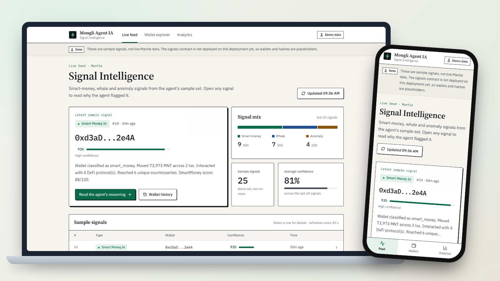
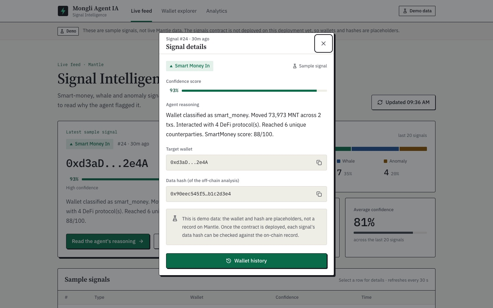
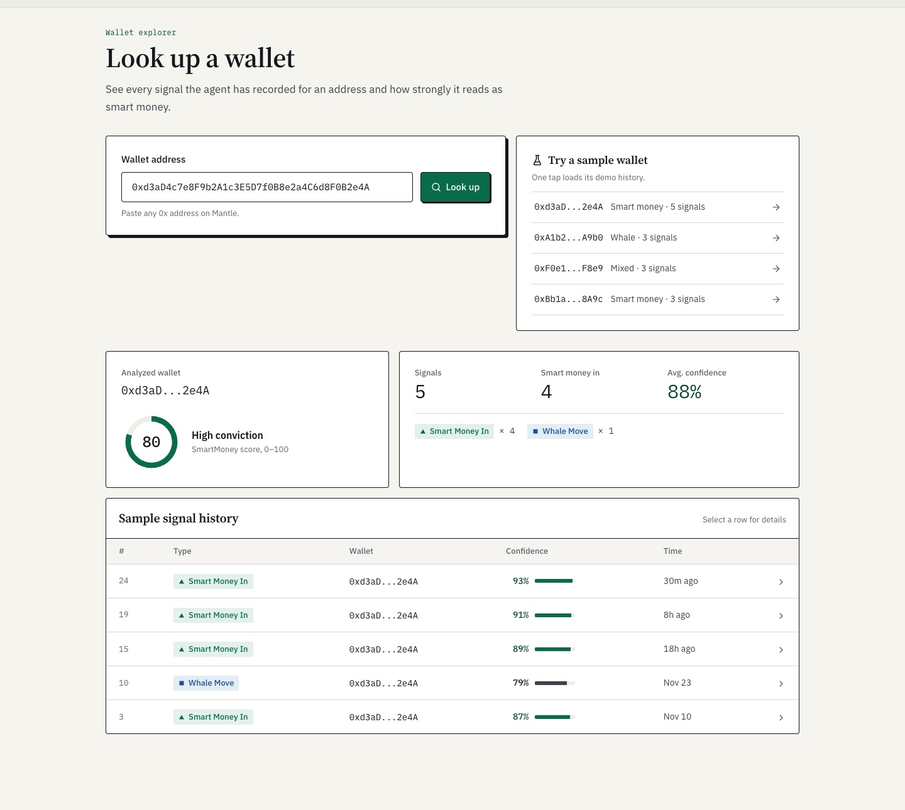
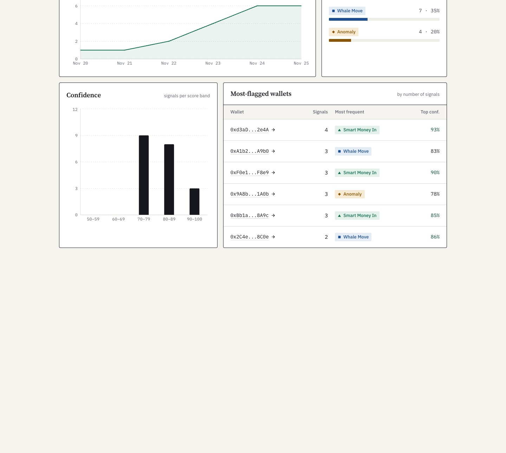
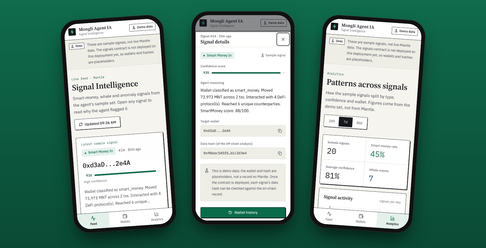
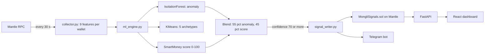

<div align="center">


# Mongli Agent IA

### An AI agent that flags smart-money, whale and anomaly moves on Mantle — and writes every signal on-chain with an auditable hash.

[](https://mongli-agent-ia.vercel.app)
[](#-hackathon)
[](https://github.com/ALFA117/Mongli_Agent_IA/actions/workflows/ci.yml)
[](LICENSE)


<br/>



**[▶ Open the dashboard](https://mongli-agent-ia.vercel.app)** · **[How it works](#-how-it-works)** · **[Run it](#-run-it-locally)** · **[AI pipeline](docs/ai-pipeline.md)**

</div>

---

> [!IMPORTANT]
> **Current status: demo data.** The `MongliSignals` contract is not deployed yet, so the public dashboard runs on a **sample set of signals** — wallets and hashes are placeholders, not Mantle records. Every screen says so with a *Demo* banner. The agent, contract and API are in this repo and run locally; deployment steps are tracked in [PENDING.md](PENDING.md).

## 🎯 The problem

On-chain "alpha" bots tell you a wallet is smart money, but you can't check *why* they said it or *when*. Their calls are off-chain and can be rewritten after the fact.

## 💡 The idea

An autonomous agent polls Mantle every 30 s, builds a 9-feature profile per wallet, scores it with three models and, when confidence is **≥ 70 %**, calls `recordSignal(wallet, type, confidence, dataHash)` on a Solidity contract. The `dataHash` is the `keccak256` of the full off-chain analysis, so anyone can later check that the reasoning shown matches what was recorded on-chain.

```
Signal #24 · SMART_MONEY_IN · 93 %
"Wallet classified as smart_money. Moved 73,973 MNT across 2 txs. Interacted with 4 DeFi
 protocol(s). Reached 6 unique counterparties. SmartMoney score: 88/100."
```
<sub>Example from the dashboard's sample set.</sub>

## ✨ The dashboard

<table>
<tr>
<td width="50%"><p align="center"><sub><b>Signal details:</b> confidence, the agent's reasoning, wallet and data hash.</sub></p></td>
<td width="50%"><p align="center"><sub><b>Wallet explorer:</b> SmartMoney score ring and full history; supports <code>?address=</code> deep links.</sub></p></td>
</tr>
<tr>
<td width="50%"><p align="center"><sub><b>Analytics:</b> activity, type mix, confidence bands and most-flagged wallets (24h / 7d / 30d).</sub></p></td>
<td width="50%"><p align="center"><sub><b>Mobile:</b> bottom tab bar for Feed, Wallets and Analytics.</sub></p></td>
</tr>
</table>

## 🧠 How it works



| Model | Role |
|:--|:--|
| **IsolationForest** (`n=200`, `contamination=0.06`) | Flags wallets whose patterns are statistical outliers |
| **KMeans** (`k=5`) | Archetype: retail · whale · smart_money · bot · new_wallet |
| **SmartMoney score** | Rule-based 0–100: avg tx value, DeFi interactions, frequency, counterparties, contract calls |

Details, the full original diagram and the project tree: **[docs/ai-pipeline.md](docs/ai-pipeline.md)** · [docs/architecture.md](docs/architecture.md) · backtesting method: [docs/backtesting_results.md](docs/backtesting_results.md).

## 🛠️ Stack

| Layer | Technology |
|:--|:--|
| Agent | Python 3.12 · web3.py · pandas · NumPy · scikit-learn · APScheduler |
| API & alerts | FastAPI (`/signals`, `/signals/{wallet}`, `/stats`) · python-telegram-bot (`/top5`, `/stats`, …) |
| Contract | Solidity 0.8.20 (`MongliSignals.sol`) · Hardhat · Mantle Sepolia (5003) / Mainnet (5000) |
| Dashboard | React 18 · Vite · Tailwind CSS · Recharts · ethers · React Router |
| Ops | Docker Compose · Fly.io config · GitHub Actions (pytest, Hardhat tests, Vite build) · Vercel |

## ⛓️ Contract

| Network | Chain ID | Address |
|:--|:--:|:--|
| Mantle Sepolia (testnet) | 5003 | *not deployed yet* |
| Mantle Mainnet | 5000 | *not deployed yet* |

## 🚀 Run it locally

```bash
git clone https://github.com/ALFA117/Mongli_Agent_IA.git
cd Mongli_Agent_IA
cp .env.example .env      # fill in your keys
make install              # Python + frontend + contracts deps
```

<details>
<summary><b>Deploy, agent, API and dashboard</b></summary>

```bash
make deploy-testnet   # deploy MongliSignals to Mantle Sepolia (fund the wallet at faucet.sepolia.mantle.xyz first)
make agent            # run the agent (or: docker compose up -d)
make api              # FastAPI at http://localhost:8000/docs
make frontend         # dashboard at http://localhost:5173
make test             # agent smoke test (CI also runs pytest and Hardhat tests)
```

| Variable | Description |
|:--|:--|
| `DEPLOYER_PRIVATE_KEY` | Wallet that deploys the contract |
| `AGENT_PRIVATE_KEY` | Wallet that writes signals on-chain |
| `CONTRACT_ADDRESS` | Filled after deploy |
| `TELEGRAM_BOT_TOKEN` | From @BotFather |
| `SCAN_INTERVAL_SECONDS` | Polling interval (default: 30) |
| `MIN_CONFIDENCE_THRESHOLD` | Min confidence to write a signal (default: 70) |

All variables: [`.env.example`](.env.example). Without `VITE_CONTRACT_ADDRESS` the dashboard runs in demo mode.

</details>

## 🏆 Hackathon

Built for **Turing Test 2026** (Mantle Network) — **AI Alpha & Data** track. Submission draft: [SUBMISSION.md](SUBMISSION.md) · remaining steps: [PENDING.md](PENDING.md) · contributing: [CONTRIBUTING.md](CONTRIBUTING.md).

## 📄 License

[MIT](LICENSE)

---

<div align="center">

**AI-generated alpha you can audit.**

</div>
